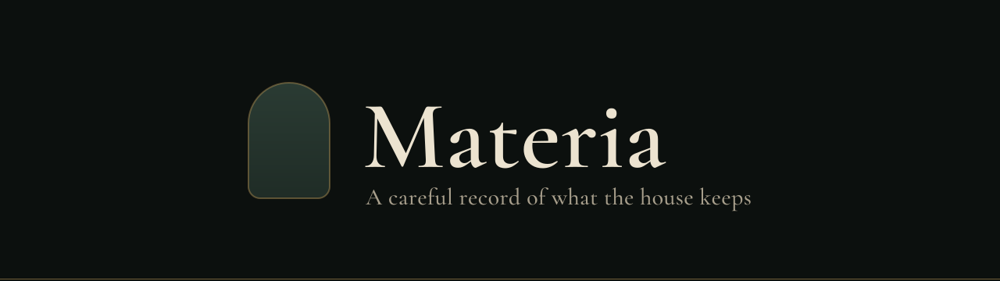

<p align="center">
  
</p>

<p align="center">
  <a href="https://github.com/davidbane/materia/actions/workflows/ci.yml"></a>
</p>

Materia is a catalog of what the house holds: every room, every drawer, and what's inside. It knows what's running low, what was moved, and which bin to open.

## What it keeps

- **Places.** Rooms, furniture, containers and slots, in one tree. Name them the way the household does: "Hall closet", not "Closet 2".
- **Stock.** Each item has a count and an optional par. Under par is Low, double par is Surplus.
- **Print labels.** Give a place a printed code like `C-07-B`, then find it by that code.
- **History.** Items remember where they've been.

## The household

Materia is the first service in Keep. In an apothecary, *materia medica* was the record of every substance on the shelf. This is the same idea, for batteries.

| Name | What it is | Where |
|---|---|---|
| **Keep** | The collection of home services and their shared packages | The `@keep` package scope |
| **Materia** | The storage catalog: an API and a web app | `backend/`, `apps/materia-web/` |
| **Apothecary** | The design system: bottle green and bone, a thread of brass, and one jewel-toned sapphire for everything you can press | `@keep/ui`, `@keep/apothecary-tokens`, `docs/design-system/` |

## Getting started

Materia needs Node 22+ (`.nvmrc` pins 24, the current LTS) and Yarn 4. The exact Yarn version is pinned in `package.json` (`packageManager`), and Corepack picks it up.

```sh
nvm install       # reads .nvmrc; afterwards `nvm use` in this folder
corepack enable   # once per Node install (Node 25+: npm install -g corepack first)
yarn install
yarn dev          # builds tokens, then runs Materia at http://localhost:5173
```

The app starts with sample data, so it runs without the backend.

### Backend

The API is Django REST Framework on Postgres.

```sh
cd backend
python3 -m venv .venv && source .venv/bin/activate
pip install -r requirements.txt
cp .env.example .env               # then set SECRET_KEY (command inside) and DATABASE_URL
python manage.py migrate
python manage.py runserver        # or `yarn api` from the root with the venv active
```

Settings come from `backend/.env` (or real environment variables): `SECRET_KEY`, `DEBUG`, `ALLOWED_HOSTS` and `DATABASE_URL`. `.env` is git-ignored; `.env.example` lists every setting.

The app needs one residence before it will load. Add it from the shell:

```sh
python manage.py shell -c "from materia.models import Owner, Residence; owner = Owner.objects.create(username='david'); Residence.objects.create(owner=owner, name='My House', residence_type='house')"
```

### Connecting the two

To use the real API, create `apps/materia-web/.env.local` with:

```sh
VITE_DATA_SOURCE=api
```

In dev, Vite proxies `/api` to `http://localhost:8000`, so the browser sees one origin: Django's session cookie and CSRF token work with no CORS setup. The axios client (`apps/materia-web/src/api/client.js`) sends the `csrftoken` cookie back as `X-CSRFToken`.

The API returns the shapes in `src/models.js`, and `src/api/endpoints.js` lists the calls. The only thing the app adds is each location's `kind`, worked out from its depth (`deriveKinds`). State lives in a Pinia store (`src/stores/house.js`).

## Commands

| Command | What it does |
|---|---|
| `yarn dev` | Run Materia at http://localhost:5173 |
| `yarn api` | Run the API, with the virtualenv active |
| `yarn docs` | Run the live design system docs at http://localhost:5174 |
| `yarn build` | Build everything |
| `yarn lint` | Lint the frontend (`yarn lint:fix` applies what it can) |
| `yarn lint:py` | Check backend formatting (`yarn lint:py:fix` applies it) |
| `yarn tokens` | Rebuild tokens and `docs/design-system/tokens.md` after editing `tokens.json` |

CI runs lint, the build, and the backend tests on Postgres for every pull request.

To add a dependency to one workspace, run `yarn workspace materia-web add <pkg>` (or `@keep/ui`, `@keep/apothecary-tokens`). Yarn uses a plain `node_modules` layout, set in `.yarnrc.yml`.

## Layout

```
packages/
  apothecary-tokens/  @keep/apothecary-tokens  design tokens → CSS variables + a Tailwind v4 theme
  ui/                 @keep/ui                 Vue 3 components built on those tokens
apps/
  materia-web/        the catalog: Vue 3, Pinia, axios, Vue Router
  design-docs/        live design system docs (yarn docs)
docs/
  design-system/      guidelines: principles, foundations, layout, components, token reference
backend/              Django + DRF API (moved in from davidbane/homeapi, history kept)
```

The packages are Yarn workspaces, so a change to a component shows up in the app on save. When a second Keep service needs them outside this repo, publish `@keep/apothecary-tokens` and `@keep/ui` (GitHub Packages works well) and version them with Changesets.

## Apothecary

Gothic in the voice, modern in the build. The full guide is in [`docs/design-system`](docs/design-system/README.md): principles, foundations, layout, every component, and a generated token reference with contrast ratios. `yarn docs` shows it all live, in both themes.

### Rules worth remembering

- **Sapphire means "act".** One `variant="primary"` button per view. Brass is ornament only; nothing decorative is blue.
- **Display face for headlines only.** Item names, paths, counts, quantities and controls are Inter.
- **Status is a fixed vocabulary:** Low, Surplus, Long-term, Stocked (`statusLabel` in `@keep/ui`). The app decides which one applies (`status()` in `apps/materia-web/src/stores/house.js`); components only display it.
- **Depth is lit from above:** sunken for inputs, raised for cards and lists, floating for the tab bar and docks.
- **One URL per state at every width.** `/rooms/hall-closet?in=drawer-b&item=9v-batteries` shows a detail pane on desktop and the item screen on a phone.

### How the styling fits together

1. **`packages/apothecary-tokens/src/tokens.json`** is the source of truth: colors per theme (`night`, `parchment`), type styles, spacing, radii, shadows and breakpoints. It's the same file the Apothecary design-system page uses.
2. **`yarn tokens`** compiles it into
   - `dist/tokens.css`: raw `--ap-*` custom properties, one block per `[data-theme]`
   - `dist/theme.css`: a Tailwind `@theme` that maps utilities onto those properties, plus `type-*` utilities for each text style.
3. **`@keep/ui/styles.css`** imports both, adds base styles and a few system utilities (`sheen`, `feature-wash`), and points Tailwind at the component sources.
4. **The app's `style.css`** is two lines: `@import "tailwindcss";` then `@import "@keep/ui/styles.css";`.

Because utilities resolve to CSS variables, switching `data-theme` on `<html>` re-themes everything with no rebuild (`useTheme()` handles that and remembers the choice).

### Tailwind vocabulary

The theme **replaces** Tailwind's default palette, radii, shadows, fonts and breakpoints, so only system values exist:

| Kind | Utilities |
|---|---|
| Color | `bg-surface-0/1/2`, `text-ink`, `text-ink-muted`, `bg-sapphire`, `text-sapphire-ink`, `bg-oxblood-tint`, `border-brass`, `bg-bottle`, … |
| Type | `type-display-2xl`, `type-display-xl`, `type-display-lg`, `type-title`, `type-numeral`, `type-body`, `type-body-strong`, `type-meta`, `type-caption`, `type-code` |
| Depth | `shadow-raised`, `shadow-raised-hover`, `shadow-sunken`, `shadow-glow`, `shadow-float`, `shadow-dock`, `shadow-sheet` |
| Radius | `rounded-sm` 6, `rounded-md` 12, `rounded-lg` 20, `rounded-pill` |
| Breakpoints | `sm:` 600px, `md:` 960px (desktop: sidebar, split panes), `lg:` 1280px |
| Layout | `max-w-page`, `w-sidebar`, `w-pane` |

Spacing stays Tailwind's 4px scale, which matches the system (`p-5` is `space-5`, 20px).

### Components

Everything comes from `@keep/ui`.

- **Layout:** `ApShell`, `ApContainer`, `ApSidebar`, `ApBrand`, `ApNavGroup`, `ApNavItem`, `ApTabBar`, `ApTab`, `ApFab`, `ApDock`, `ApPageHead`, `ApSection`, `ApSplit`, `ApTileGrid`
- **Content:** `ApList`, `ApListRow`, `ApLocationTile`, `ApPanel`, `ApFeature`, `ApStat`, `ApBreadcrumb`, `ApBinTag`, `ApStatusChip`
- **Controls:** `ApButton`, `ApIconButton`, `ApSearchField`, `ApStepper`
- **Composables:** `useTheme()`, `useIsDesktop()`, `useMediaQuery()`

Icons are [Tabler](https://tabler.io/icons) outline icons via `@tabler/icons-vue`, at stroke 1.5.
